# Employee Management & Loan CRM System

Web URL : https://navistone.in/employee_management/login

A web-based **Employee Management + Loan Business CRM** built with **Laravel 11**, made for a loan DSA (Direct Selling Agent) company. It brings HR operations (employees, attendance, breaks, leaves) together with the sales pipeline (call-back follow-ups, MIS / loan disbursement tracking, connectors, RM & DSA details) and company finances (monthly expenditure), all behind **role-based access control**.

> ℹ️ This repository is a **project showcase**. It has the project overview and screenshots only. The source code is not public.

---

## 📸 Screenshots

| Login | Admin Dashboard |
|---|---|
| 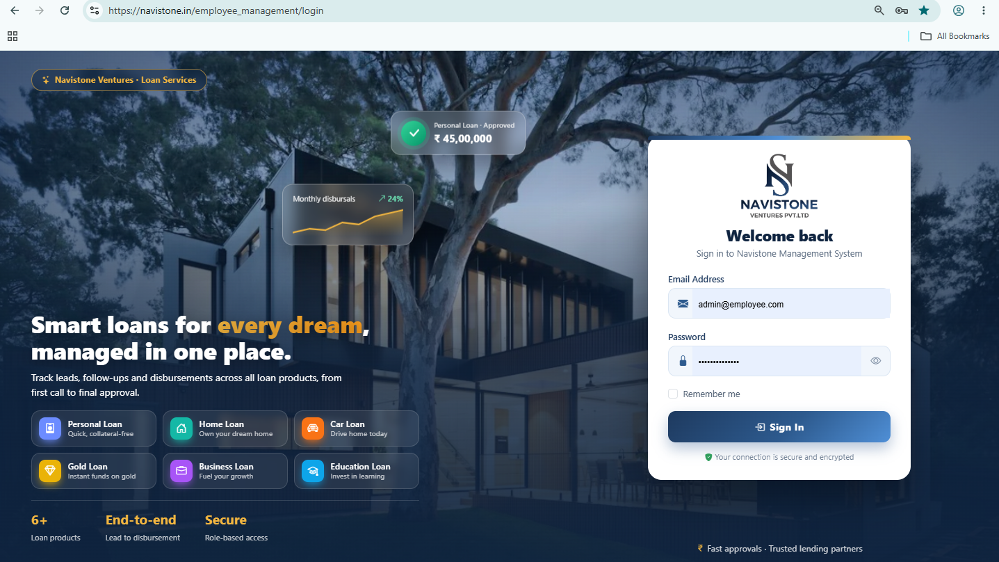 | 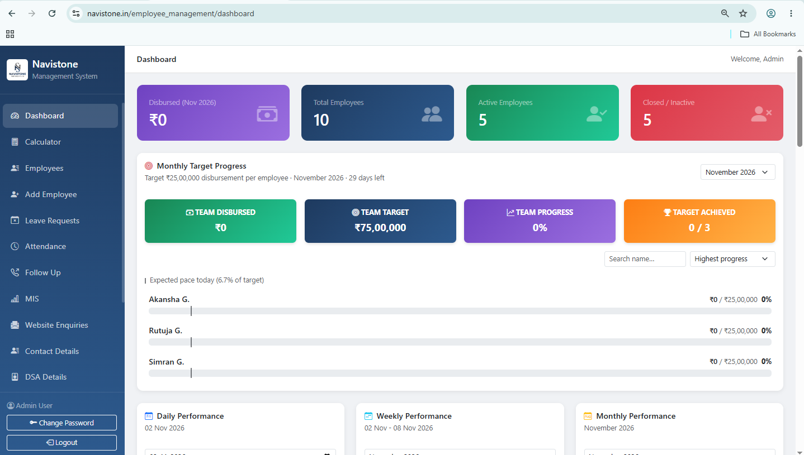 |

| Employees | Attendance |
|---|---|
| 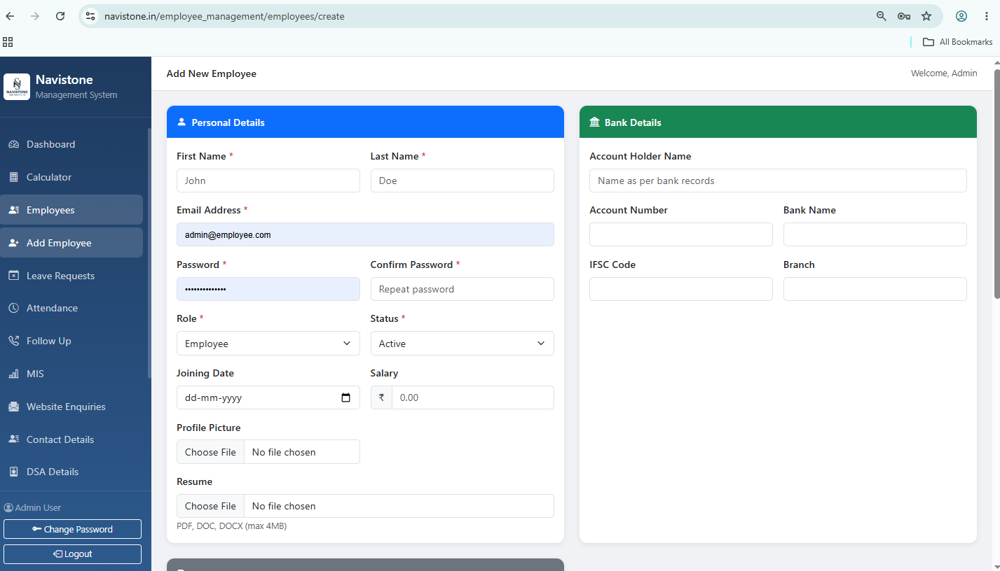 | 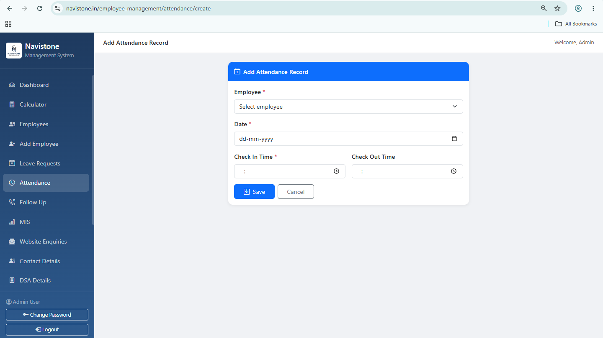 |

| Follow Ups (Call Back) | MIS |
|---|---|
| 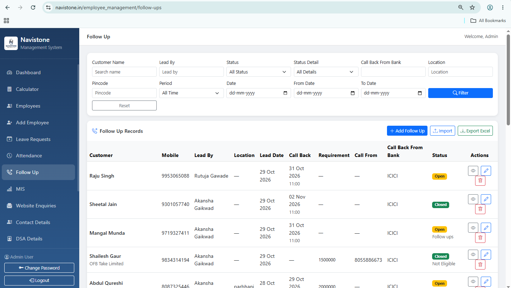 | 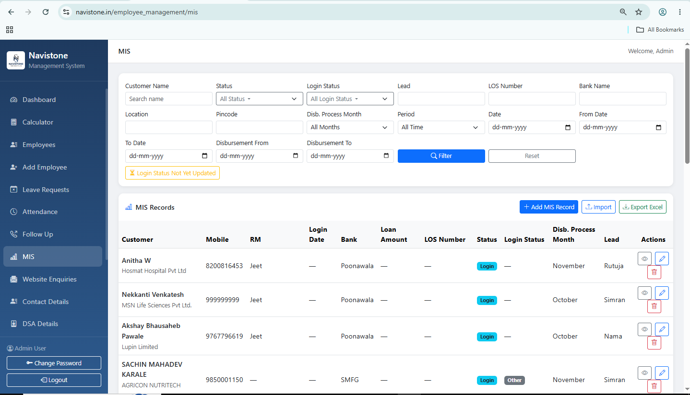 |

| Expenditure Summary | Role Privileges |
|---|---|
| 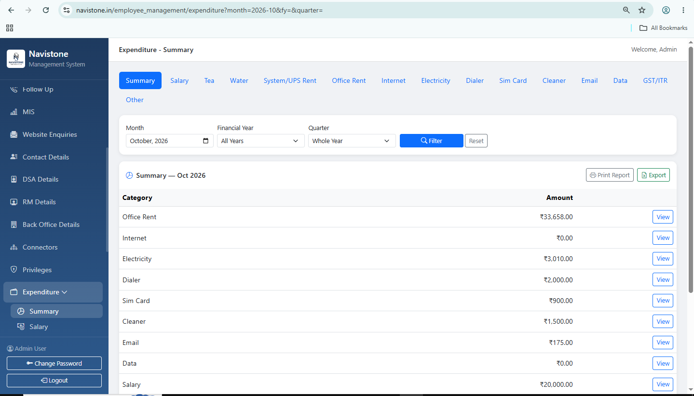 | 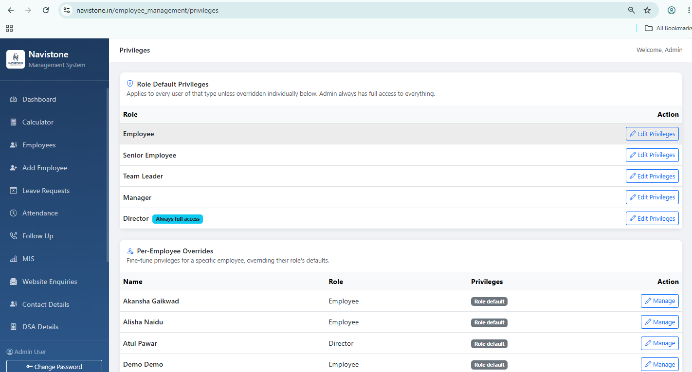 |

| Employee Dashboard | EMI Calculator |
|---|---|
| 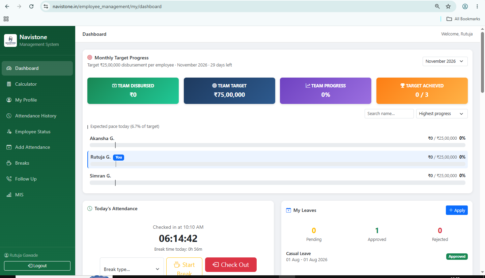 | 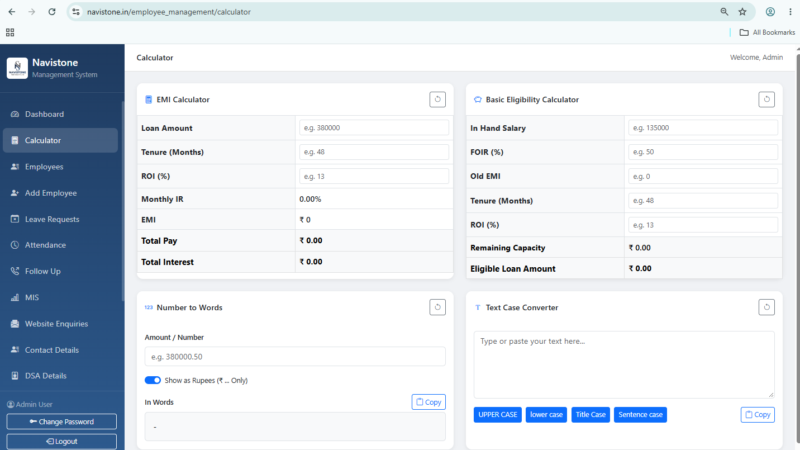 |

| Company Website |
|---|
| 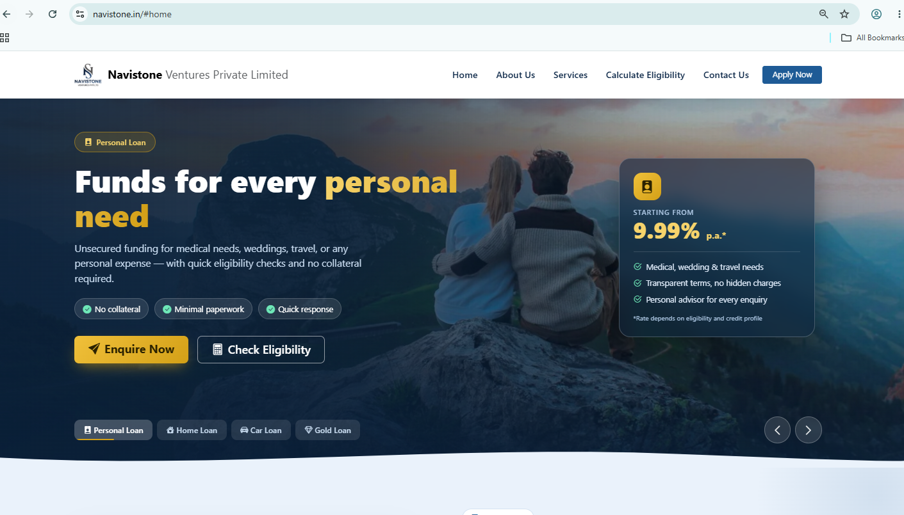 |

---

## ✨ Key Features

### 👥 Employee Management
- Add, view, edit and deactivate employee accounts (Admin creates all accounts; there is no self-registration)
- Detailed employee profile: personal details, joining date, salary (visible to Admin only), profile photo
- Education details, qualifications, documents and bank details
- Employee directory with search and filters
- Account status **Active / Closed**. Closed accounts cannot log in.

### ⏱️ Attendance & Breaks
- Employee **check-in / check-out** from the dashboard
- **Live "Currently Logged In" panel** showing who is working or on break, with running timers
- Break tracking with **break types** and **paid / unpaid minutes**
- Admin can start or end a break for any employee
- **Automatic checkout** for employees who forget to check out (scheduled daily job)
- Attendance report with filters, manual add/edit and **Excel export**

### 🌴 Leave Management
- Employees apply for leave and see their leave history
- Admin approves or rejects requests
- Leave report export

### 📞 Follow Ups (Call Back CRM)
- Track customer leads: company, salary, location, pincode, mobile, lead source
- Call-back date and time scheduling, plus call-backs from the bank
- **Today's follow-ups** widget on the dashboard
- **Bulk import from Excel** using a downloadable template, and export to Excel

### 📊 MIS (Loan Disbursement Tracking)
- Track each loan file: customer, requirement, RM, back office, login date, status
- Disbursement date and process month, with carry-forward of pending cases
- Excel import and export

### 🎯 Performance & Targets
- Daily, weekly and monthly performance views
- **Monthly disbursement target progress** bars for each employee
- Best-performer highlights on the dashboard

### 🤝 Business Partners & Contacts
- **Connectors**: partner details, payout and bank account info (with Excel import/export)
- **DSA Details**, **RM Details** and **Back Office Details** directories
- **Contact Details** directory
- **Website Enquiries**: leads submitted from the company website's "Contact Us" form

### 💰 Monthly Expenditure (Billing)
Tracks every recurring company expense, organised by month and fiscal year:
- Salaries · Office Rent · System Rent
- Electricity · Internet · Dialer · Data · SIM Card · Email bills
- Tea (rate × entries) · Water delivery · Cleaner
- GST / ITR · Other expenses
- **Summary dashboard** with month-wise totals and reports

### 🧮 EMI Calculator
- Built-in loan **EMI calculator**, plus a reverse mode that works out the loan amount from a given EMI

### 🌐 Company Website
- Public marketing website for the loan products (Personal, Home, Car and Gold loans) with a Contact Us form that feeds into the CRM

---

## 🔐 Roles & Privileges

| Role | Access |
|---|---|
| **Admin** | Full access to every module |
| **Director** | Configurable |
| **Manager** | Configurable |
| **Team Leader** | Configurable |
| **Senior Employee** | Configurable |
| **Employee** | Configurable |

The Admin sets privileges **per role and per user** from a privilege matrix:

- **Actions:** View · Add · Edit · Delete · Export
- **Scope:** *Own records only* or *All records* (for Employees, Leaves, Attendance, Breaks, Follow Ups and MIS)
- **Modules:** Employee Directory, Leaves, Attendance, Breaks, Follow Ups, MIS, Performance, Website Enquiries, Profile, DSA, RM, Back Office

---

## 🛠️ Tech Stack

| Layer | Technology |
|---|---|
| Backend | PHP 8.2, Laravel 11 |
| Frontend | Blade templates, Bootstrap 5, Bootstrap Icons, JavaScript |
| Database | MySQL |
| Excel Import/Export | Custom in-house XLSX reader/writer (no external library) |
| Scheduler | Laravel Task Scheduler (auto checkout) |
| Server | Apache (XAMPP) |

---

## 📁 Modules at a Glance

```
├── Authentication (single login, role-based redirect)
├── Admin Panel
│   ├── Dashboard
│   ├── Employees
│   ├── Attendance & Employee Status
│   ├── Leave Requests
│   ├── Follow Ups
│   ├── MIS
│   ├── Connectors / DSA / RM / Back Office / Contacts
│   ├── Website Enquiries
│   ├── Expenditure (15+ bill types + Summary)
│   ├── Privileges
│   └── EMI Calculator
├── Employee Portal
│   ├── Dashboard (check-in/out, breaks, targets, today's follow-ups)
│   ├── My Profile
│   ├── My Attendance
│   ├── My Leaves
│   └── Modules allowed by privileges
└── Public Website (Home + Contact Us)
```

---

## 👩‍💻 Author

**Manjushree Chabukswar**

---

© 2026 All rights reserved. This project is shared for showcase purposes only.
